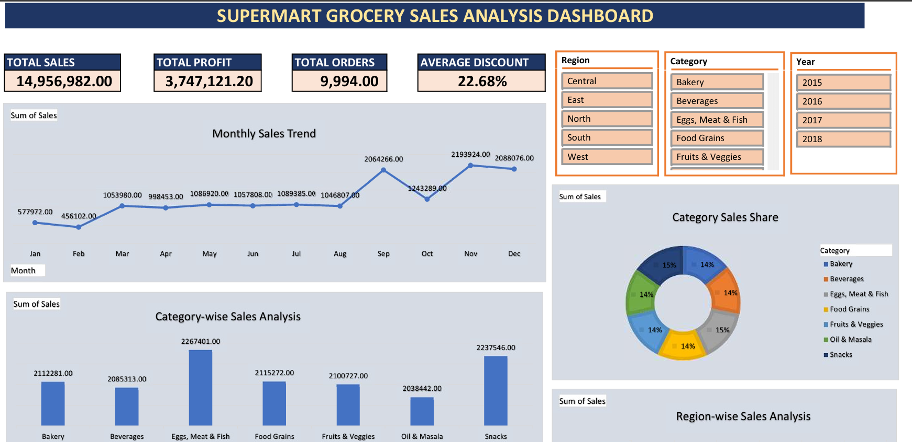
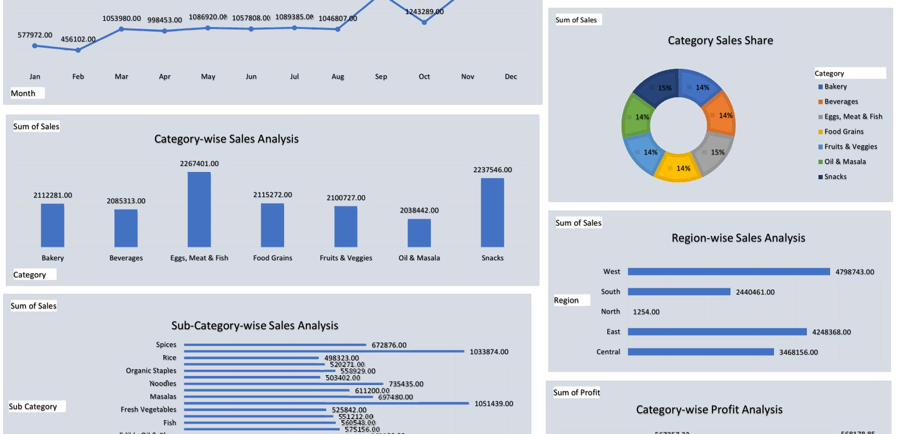

# Supermart Grocery Sales Analysis

## Project Overview
This project analyzes Supermart grocery sales data using Microsoft Excel to identify sales trends, profitability, category performance, and regional performance. An interactive dashboard was developed to support data-driven business decisions.

## Tools Used
- Microsoft Excel
- PivotTables and PivotCharts
- Excel Formulas
- Slicers and Interactive Dashboard
- Data Cleaning and Visualization

## Key Performance Indicators (KPIs)
- **Total Sales:** ₹14,956,982
- **Total Profit:** ₹3,747,121.20
- **Total Orders:** 9,994
- **Average Discount:** 22.68%

## Dashboard Features
- Category-wise Sales Analysis
- Region-wise Sales Analysis
- Sub-Category-wise Sales Analysis
- Category-wise Profit Analysis
- City-wise Sales Analysis
- Monthly Sales Trend
- Category Sales Share
- Interactive filters for Region, Category, and Year

- ## Dashboard Preview

## Project Structure
- `README.md` — Project overview and documentation
- `Screenshots/` — Dashboard and chart screenshots
- `Supermart_Grocery_Sales_Analysiss.xlsx` — Excel analysis workbook

## Key Insights
- Eggs, Meat & Fish was the highest-sales category in the analysis.
- Snacks generated the highest profit among the categories.
- The West region recorded the highest sales.
- 2018 was the highest-sales year in the dataset.
- November recorded the highest monthly sales.

## Learning Outcomes
- Cleaned and prepared sales data in Excel.
- Created KPI summaries using formulas.
- Built PivotTables, PivotCharts, and interactive slicers.
- Designed a dashboard to explore sales and profit performance.

## Author
**Rohit Kumar**

Aspiring Data Analyst | Excel | SQL | Power BI | Python

